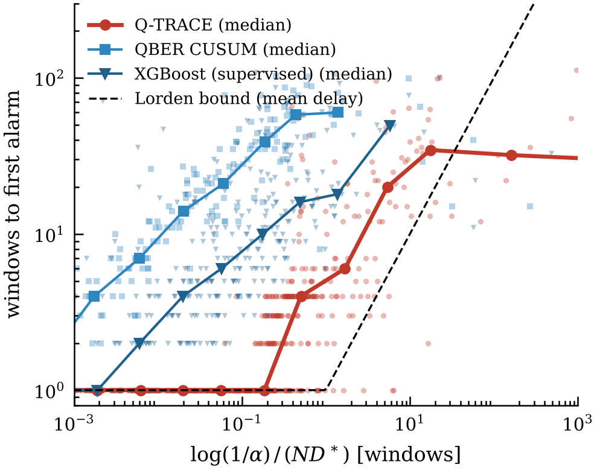
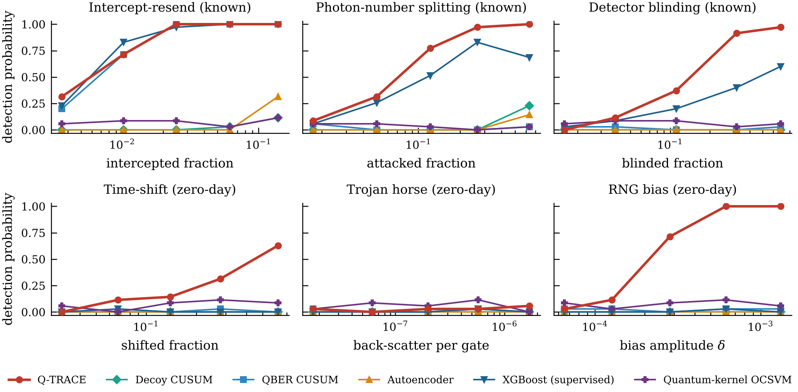

# Q-TRACE: Quantum Telemetry Residuals Against Calibrated Expectations

[](https://github.com/Sumitchongder/Q-TRACE/actions/workflows/ci.yml)
[](LICENSE)
[](pyproject.toml)
[](https://www.ibm.com/quantum/qiskit)

**Q-TRACE (Quantum Telemetry Residuals Against Calibrated Expectations): physics-based zero-day attack detection for decoy-state QKD, with information-theoretic
detectability bounds and validation on IBM Quantum hardware.**

Q-TRACE detects implementation attacks on a quantum-key-distribution link *without ever seeing an
attack*. It tests every telemetry window against the **honest-device manifold**, the set of outcome
statistics that an attack-free decoy-state BB84 link can produce under arbitrary channel loss, and
raises an alarm when no honest explanation remains. The same construction yields a detector-independent
**detectability exponent** `D*` that bounds how fast *any* telemetry monitor (classical, deep or
quantum) can detect a given attack, and identifies attacks that no monitor can detect at all.

<p align="center">
  
  
</p>

## Contributions

1. **Honest-manifold detector.** Per-link maximum-likelihood calibration of the device
   (`e_Z, e_X, p_d0, p_d1, κ, ρ`) on commissioning data; per-window profiling of the transmittance as a
   nuisance parameter (loss is not a security-relevant deviation in decoy-state QKD); three families of
   alarm channels: an omnibus Freeman–Tukey residual test, a physics score test (Rao / Neyman C(α)) over
   the directions in which device parameters can move, and a setting-allocation test, each with a
   drift-robust moving-reference variant. No attack data are used anywhere.
2. **Detectability theory.** `D* = min_η KL(Q ‖ P_η)` per pulse gives, through Lorden's theorem, a lower
   bound `log(1/α)/(N D*)` on the mean detection delay of any detector at false-alarm rate `α`. A
   Trojan-horse attack with filtered back-reflection has `D* = 0` exactly: it is provably invisible to
   every telemetry-based monitor.
3. **QKD-TRACE v2 benchmark.** A count-level decoy-state twin with full per-detector outcome tables,
   photon-number-resolved attack physics (PNS with lossless channel, stealthy faked-state blinding,
   time-shift efficiency mismatch, intercept–resend, Trojan horse, RNG bias, compositions), benign
   faults, and deliberate model mismatch (afterpulsing, intensity jitter, polarisation and temperature
   drift) that the detector does not model.
4. **Hardware validation.** Up to 40 crosstalk-isolated BB84 links run in parallel on one IBM Heron
   processor, with eavesdroppers *physically executed* as tunable entangling (`RZX/RXX`) and
   amplitude-damping probes. Eve's ancilla is measured, giving her information gain (and the
   information leaked before the first alarm) on real hardware.

## Results

<!-- RESULTS:BEGIN -->
**Attacked links detected (%) and attack-free links with any alarm (FA, %)** at a per-window false-alarm rate of 10⁻³; mean ± 95 % CI over 5 held-out seeds.

| Method | known | zero-day | composite | physical shift | FA honest | FA loss fault | FA honest (shift) |
|---|---|---|---|---|---|---|---|
| **Q-TRACE** | 63.6 ± 6.6 | 28.0 ± 2.5 | 65.3 ± 9.1 | 32.0 ± 7.5 | 5.2 ± 3.8 | 0.0 ± 0.0 | 3.2 ± 2.2 |
| XGBoost (supervised) | 51.2 ± 8.5 | 0.6 ± 0.6 | 42.3 ± 10.8 | 24.4 ± 9.2 | 0.8 ± 1.4 | 8.8 ± 6.5 | 0.0 ± 0.0 |
| QBER CUSUM | 27.2 ± 5.3 | 1.3 ± 2.5 | 21.0 ± 3.8 | 9.8 ± 3.7 | 1.2 ± 2.2 | 1.6 ± 2.7 | 0.0 ± 0.0 |
| Decoy CUSUM | 2.5 ± 2.8 | 0.0 ± 0.0 | 0.3 ± 0.9 | 0.0 ± 0.0 | 0.0 ± 0.0 | 3.2 ± 2.2 | 0.0 ± 0.0 |
| QBER static | 13.1 ± 6.0 | 1.7 ± 1.3 | 11.7 ± 7.3 | 50.7 ± 7.4 | 2.8 ± 2.8 | 0.8 ± 2.2 | 45.6 ± 16.7 |
| Autoencoder | 3.0 ± 2.7 | 0.0 ± 0.0 | 1.3 ± 1.7 | 0.9 ± 1.5 | 0.0 ± 0.0 | 4.0 ± 8.6 | 0.0 ± 0.0 |
| Isolation Forest | 3.6 ± 4.6 | 0.4 ± 1.1 | 5.0 ± 8.5 | 0.0 ± 0.0 | 0.0 ± 0.0 | 12.0 ± 8.6 | 0.0 ± 0.0 |
| One-class SVM | 0.0 ± 0.0 | 0.0 ± 0.0 | 0.0 ± 0.0 | 0.0 ± 0.0 | 0.0 ± 0.0 | 0.0 ± 0.0 | 0.0 ± 0.0 |
| Quantum-kernel OCSVM | 5.7 ± 2.5 | 6.7 ± 2.4 | 4.3 ± 2.8 | 8.9 ± 6.2 | 10.4 ± 3.2 | 12.8 ± 4.2 | 7.2 ± 5.4 |

**Window-level AUROC** (mean ± 95 % CI):

| Method | known | zero-day | composite | physical shift |
|---|---|---|---|---|
| **Q-TRACE** | 0.859 ± 0.033 | 0.636 ± 0.032 | 0.858 ± 0.034 | 0.699 ± 0.032 |
| XGBoost (supervised) | 0.848 ± 0.026 | 0.499 ± 0.043 | 0.771 ± 0.041 | 0.718 ± 0.041 |
| QBER CUSUM | 0.664 ± 0.043 | 0.533 ± 0.045 | 0.664 ± 0.034 | 0.624 ± 0.019 |
| Decoy CUSUM | 0.746 ± 0.022 | 0.546 ± 0.031 | 0.724 ± 0.067 | 0.660 ± 0.036 |
| QBER static | 0.567 ± 0.064 | 0.487 ± 0.072 | 0.545 ± 0.065 | 0.571 ± 0.075 |
| Autoencoder | 0.800 ± 0.036 | 0.573 ± 0.017 | 0.766 ± 0.020 | 0.663 ± 0.036 |
| Isolation Forest | 0.767 ± 0.033 | 0.554 ± 0.014 | 0.745 ± 0.049 | 0.677 ± 0.033 |
| One-class SVM | 0.814 ± 0.021 | 0.571 ± 0.027 | 0.775 ± 0.029 | 0.677 ± 0.026 |
| Quantum-kernel OCSVM | 0.523 ± 0.018 | 0.498 ± 0.013 | 0.521 ± 0.014 | 0.501 ± 0.025 |

**IBM Quantum hardware** (`hardware_ibm_marrakesh_20261121T124423Z`), fraction of link-epochs flagged at alpha = 10^-3 with a condition-matched reference (each link's honest monitoring epochs). With the pre-registered commissioning reference, every test, including the QBER monitors, flagged 92 % of honest link-epochs: commissioning circuits lacked the idle period and concurrent two-qubit activity of monitoring circuits, producing an X-basis dephasing shift of about 1.9 %. See `docs/hardware.md`.

| probe | n | ideal_qber | measured_qber_excess | Q-TRACE@0.001 | QBER (per basis)@0.001 | QBER (pooled)@0.001 |
|---|---|---|---|---|---|---|
| ad(gamma=0.030) | 13 | 0.0113 | 0.0282 | 1.0 | 1.0 | 1.0 |
| ad(gamma=0.060) | 12 | 0.0226 | 0.0349 | 1.0 | 1.0 | 1.0 |
| ad(gamma=0.120) | 12 | 0.0455 | 0.0599 | 1.0 | 1.0 | 1.0 |
| ad(gamma=0.250) | 14 | 0.0960 | 0.1005 | 1.0 | 1.0 | 1.0 |
| honest | 66 | 0.0000 | 0.0000 | 0.0 | 0.0 | 0.0 |
| probe(theta=0.150) | 14 | 0.0028 | 0.0049 | 1.0 | 0.9285714285714286 | 0.6428571428571429 |
| probe(theta=0.250) | 13 | 0.0078 | 0.0087 | 0.9230769230769232 | 0.8461538461538461 | 0.8461538461538461 |
| probe(theta=0.400) | 14 | 0.0197 | 0.0211 | 1.0 | 1.0 | 1.0 |
| probe(theta=0.600) | 14 | 0.0437 | 0.0434 | 1.0 | 1.0 | 1.0 |
| probe(theta=0.900) | 13 | 0.0946 | 0.0905 | 1.0 | 1.0 | 1.0 |
| probe(theta=1.571) | 13 | 0.2500 | 0.2310 | 1.0 | 1.0 | 1.0 |
<!-- RESULTS:END -->

All simulated results come from five held-out seeds (101–105) that played no role in any design or
tuning decision (development used seeds 0–3). Thresholds for every method are set on attack-free
validation links at the same per-window false-alarm rate. Full tables: [`results/summary/`](results/summary).

## Quick start

```bash
git clone https://github.com/Sumitchongder/Q-TRACE.git && cd Q-TRACE
pip install -r requirements.txt && pip install -e .
pytest -q                                    # 18 unit tests, < 1 min
make smoke                                   # end-to-end benchmark on a tiny configuration
make reproduce                               # full benchmark + rehearsal + figures (~2 h, 1 core)
```

Detect attacks on your own telemetry:

```python
from qtrace.detect.detector import QTraceDetector
det = QTraceDetector()
raw_score, channels, z, link, eta = det.score_run(counts, n_cal=60, mu_s=0.5,
                                                  afterpulse_spec=0.01)
# counts: int array (windows, 3 intensities, 2 bits, 2 Alice bases, 2 Bob bases, 4 outcomes)
```

## IBM Quantum hardware run

Open [`notebooks/01_qpu_hardware_run.ipynb`](notebooks/01_qpu_hardware_run.ipynb). The notebook selects
links on the least busy Heron device, runs a pilot job to measure the actual QPU cost per shot on your
account, sizes the main job to a budget (`BUDGET_SECONDS = 360` by default), and writes raw per-shot data
to `results/hardware/`. Nothing is submitted until `CONFIRM = True`. Validate the full pipeline
offline first:

```bash
make rehearsal      # noisy FakeMarrakesh rehearsal, identical data format, no QPU time
```

Rehearsal outputs are written to `figures/rehearsal/` and `results/summary/rehearsal/` and are never
reported as hardware results. See [`docs/hardware.md`](docs/hardware.md).

## Repository layout

```
src/qtrace/
  physics/     optics.py (receiver outcome model), decoy.py (decoy bounds, key rate, telemetry)
  twin/        simulator.py (links, drift, model mismatch, faults, window sampling)
  attacks/     models.py (six physically derived attacks + compositions)
  detect/      honest_model.py, score_test.py, detector.py, detectability.py
  baselines/   detectors.py (QBER/decoy CUSUM, IF, OCSVM, AE, XGBoost, quantum-kernel OCSVM)
  evaluation/  benchmark.py (splits, thresholds, metrics)
  hardware/    design.py, circuits.py, runner.py, analysis.py
  viz/         figures.py
experiments/   run_benchmark.py, run_rehearsal.py, make_figures.py, configs/benchmark.yaml
notebooks/     01_qpu_hardware_run.ipynb
results/       benchmark/seed_*/, hardware/, summary/
figures/       publication figures (PDF + PNG)
docs/          methods.md, hardware.md, reproducibility.md
tests/         unit tests (physics invariants, attacks, calibration, hardware analysis)
```

## Reproducibility

Exact package versions are pinned in `requirements.txt`; a `Dockerfile` reproduces every simulated
result and figure (`docker build -t qtrace . && docker run qtrace`). Each seed directory stores its
configuration, thresholds, honest-null parameters, software versions and wall time in `meta.json`.
See [`docs/reproducibility.md`](docs/reproducibility.md) and [`CHANGELOG.md`](CHANGELOG.md), which
documents the methodological corrections relative to v0.1.

## Scope and limitations

Q-TRACE monitors the statistics Alice and Bob already share; it complements, and does not replace,
security proofs and device-level countermeasures. Attacks with `D* = 0` (for example a filtered
Trojan-horse probe) cannot be detected from telemetry and must be excluded by optical isolation and
power monitoring. Simulated results depend on the twin's parameter ranges, which are stated in
`src/qtrace/twin/simulator.py`; the hardware experiment emulates the channel with superconducting qubits
rather than optical fibre. See Section 6 of the paper.

## Citation

See [`CITATION.cff`](CITATION.cff).

## Acknowledgements and AI-use statement

Parts of the code and documentation were developed with the assistance of an AI model (Claude,
Anthropic). All design decisions, results and their interpretation were reviewed by the authors, who
take full responsibility for the content.

## License

MIT, see [`LICENSE`](LICENSE).
